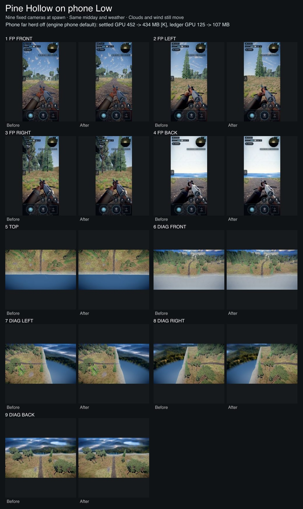

# Pine Hollow drops its phone far herd and re-reads its runtime

> Written by: Claude (lane mini-pinemem4)
> **State:** cut and reading taken 2026-11-18 (MEMORY-GATES MG9, J410, J412).

## The cut

Pine's manifest turned the far herd on for the phone (`tiers.phone`
`animalFarBatchDist: 100`, `animalHullBatch: true`, and the grid phone's
`animalFarBatchDist: 75`). The engine keeps it off on phones, because every
coloured rig spawned reserves far-herd GPU pages whether or not an animal
stands in the 100–150 m band (engine `render/tiers.ts`). The three overrides
go, so the phone takes the engine's default. The phone still hides animals
at 150 m (112.5 m in the grid); the few between 100 and 150 m draw one call
each instead of one per model.

Six alternating locked cold WebKit pairs at phone Low (engine
`plan/mg8-format-pin` `2ae1300f`, format 0.34, unprepared drafts):

| | Before | Far herd off |
| --- | ---: | ---: |
| Ledger GPU at control [L] | 125.4 MB (buffers 60.1, textures 65.2) | 107.1 MB (46.9, 60.2) |
| GPU process settled [K], median | 452 MB | 434 MB |
| WebContent settled [K], median | 777 MB | 762 MB |
| EM11 playing central (upper) | 1.007 (1.115) GB | 0.981 (1.116) GB |

The nine views match frame for frame.

## The runtime reading

`src/data/runtimeCost.json` still carried the epoch-3 Simulator reading of
2026-11-17 (engine `4a7ba050`): WebContent 753.8 + GL 156.7 MB, a 550.9 MB
runtime charge against the 536.9 MB large tier (OF10c1a), and the reason
format 0.34's estimate refused at 1,512.8 MB loading. Re-read with the far
herd off on the build above, three alternating cold Simulator Safari rounds
per texture form (`progress/memory/mg9-epoch3-2026-11-18.json`). The charged
round is the heaviest of the three:

| Form | Rounds, WebContent + GL MB | Charged | Runtime charge |
| --- | --- | --- | ---: |
| auto (ktx2) | 699 + 117, 724 + 118, 741 + 118 | 740.7 + 117.6 | 503.9 MB |
| images first | 737 + 317, 707 + 317, 734 + 317 | 737.2 + 317.2 | |

Before the cut, the same three rounds read GL 130.4 MB and WebContent
711–759 MB. Format 0.34 now admits the built folder: loading estimate
1,439.5 MB, playing 1,120.4 MB.
